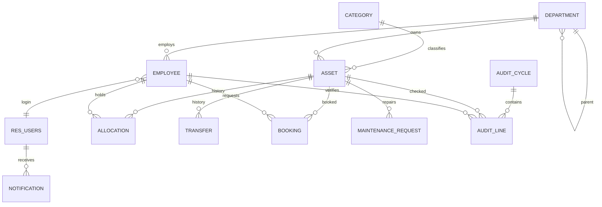

# AssetFlow domain model

Target: Odoo 19 Community, six addons. Every persistent model has a security CSV entry, an owning
addon, and a single writer for its state field.

## 1. Addon map and dependency direction

```
assetflow_base            groups, category, departments, employees, sequences,
                          notifications, activity log, signup
   |
   +-- assetflow_assets         assets, allocations, transfers
   |        |
   |        +-- assetflow_booking       bookings of shared assets
   |        +-- assetflow_maintenance   maintenance requests
   |        +-- assetflow_audit         audit cycles and lines
   |
   +-- assetflow_reports        KPI dashboard, pivot/graph data, QPDF reports
                                (depends on base + assets + booking + maintenance + audit)
```

Rules:

- Dependencies point downward only. `assetflow_base` never imports from another `assetflow_*` addon.
- Cross-addon behaviour uses manifest `depends` plus normal ORM references, never private imports
  between addon folders.
- Security groups live only in `assetflow_base`; every other addon references them by XML ID.
- Shared helpers (asset tag sequence, notification helper, activity log helper) live in base.

## 2. Naming conventions

| Thing | Convention | Example |
|-------|------------|---------|
| Technical model | `assetflow.<concept>` | `assetflow.allocation` |
| Table | dots to underscores | `assetflow_allocation` |
| Class | CamelCase, `Assetflow` prefix | `AssetflowAllocation` |
| Many2one | `*_id` | `asset_id` |
| One2many/Many2many | `*_ids` | `line_ids` |
| Booleans | `is_*`, `has_*`, `can_*` | `is_bookable` |
| Compute | `_compute_*` | `_compute_is_overdue` |
| Constraint | `_check_*` | `_check_dates` |
| View XML ID | `view_<model>_<type>` | `view_assetflow_asset_list` |

## 3. Base addon: `assetflow_base`

### 3.1 `assetflow.department`

| Field | Type | Notes |
|-------|------|-------|
| `name` | Char, required, translate | department name |
| `code` | Char, required | unique; short code for reports |
| `parent_id` | Many2one `assetflow.department` | hierarchy; `ondelete="restrict"` |
| `parent_path` | Char, index | `_parent_store = True` |
| `head_id` | Many2one `assetflow.employee` | `ondelete="set null"` |
| `child_ids` | One2many | inverse of `parent_id` |
| `complete_name` | Char, compute | path for display |
| `member_count` | Integer, compute | employees in this department |
| `active` | Boolean | default True; deactivate instead of delete |

Constraints: unique `code`; reject `parent_id == self` or a descendant cycle in `write`.

### 3.2 `assetflow.category`

| Field | Type | Notes |
|-------|------|-------|
| `name` | Char, required, translate | Electronics, Furniture, Vehicles, ... |
| `code` | Char, required | unique |
| `warranty_months` | Integer, default 0 | the brief's "category-specific field" example |
| `description` | Text | optional |
| `active` | Boolean | default True |
| `asset_count` | Integer, compute | assets in this category |

Category-specific fields beyond warranty are out of MVP scope; do not build a dynamic-field engine.
If needed later, use Odoo's `Properties` field on the asset and a definition on the category.

### 3.3 `assetflow.employee`

| Field | Type | Notes |
|-------|------|-------|
| `name` | Char, required | full name |
| `email` | Char, required | unique, lowercased on write |
| `phone` | Char | optional |
| `department_id` | Many2one `assetflow.department`, required | `ondelete="restrict"` |
| `job_title` | Char | optional |
| `user_id` | Many2one `res.users` | `ondelete="set null"`, index; login account |
| `active` | Boolean | deactivating does not delete history |
| `role` | Selection, compute | display only, derived from `user_id.groups_id` |

`role` values: `employee`, `department_head`, `asset_manager`, `admin`, `none`. It is **not**
writable. Promotion happens only through the admin-only buttons on this form (see ADR-0002).

Constraints: unique lowercased `email`; `user_id` unique when set (one employee per login).

### 3.4 `assetflow.notification`

| Field | Type | Notes |
|-------|------|-------|
| `user_id` | Many2one `res.users`, required, index | recipient |
| `title` | Char, required | short line |
| `body` | Text | detail |
| `notification_type` | Selection | `booking_reminder`, `overdue_return`, `transfer`, `maintenance`, `audit`, `system` |
| `res_model` | Char | optional deep link target |
| `res_id` | Integer | optional deep link target |
| `is_read` | Boolean, default False, index | unread badge |
| `read_at` | Datetime | when read |

Ordering: `create_date desc`. ACL: a user reads and writes only their own rows.

### 3.5 `assetflow.activity.log`

| Field | Type | Notes |
|-------|------|-------|
| `user_id` | Many2one `res.users`, required | who acted |
| `action` | Selection | `create`, `update`, `delete`, `allocate`, `return`, `transfer_request`, `transfer_approve`, `book`, `cancel`, `approve`, `reject`, `resolve`, `audit_open`, `audit_close` |
| `model_name` | Char | technical model |
| `res_id` | Integer | affected record |
| `description` | Text | human-readable detail |
| `timestamp` | Datetime, default now, index | when |

Written only through a helper in base (`_log_activity`). Read access: admin and asset manager;
employees do not get a global log view.

### 3.6 Base data

- Sequence `assetflow.asset.tag`: prefix `AF-`, padding 4, no company, produces `AF-0001`.
- Sequence `assetflow.maintenance.ref`: prefix `MR-`, padding 4.
- Sequence `assetflow.audit.ref`: prefix `AUD-`, padding 4.
- Root menu `menu_assetflow_root` ("AssetFlow", application), no action, icon
  `assetflow_base,static/description/icon.png`.

## 4. Assets addon: `assetflow_assets`

### 4.1 `assetflow.asset`

| Field | Type | Notes |
|-------|------|-------|
| `name` | Char, required | descriptive name |
| `asset_tag` | Char, required, readonly, default sequence | unique; `AF-0001` |
| `serial_no` | Char, index | unique when not empty |
| `category_id` | Many2one `assetflow.category`, required | `ondelete="restrict"` |
| `department_id` | Many2one `assetflow.department` | owning department |
| `location` | Char | free text; used by audit scope |
| `acquisition_date` | Date | optional |
| `acquisition_cost` | Monetary | reporting/ranking only, never accounting |
| `currency_id` | Many2one `res.currency` | default company currency |
| `condition` | Selection | `new`, `good`, `fair`, `poor`, `damaged`; default `good` |
| `state` | Selection | `available`, `allocated`, `reserved`, `maintenance`, `lost`, `retired`, `disposed`; default `available` |
| `is_bookable` | Boolean | shared/bookable resource flag |
| `holder_employee_id` | Many2one `assetflow.employee` | denormalized current holder |
| `expected_return_date` | Date | denormalized from the active allocation |
| `image_1920` | Image | photo |
| `allocation_ids` | One2many | allocation history |
| `transfer_ids` | One2many | transfer history |
| `booking_ids` | One2many | booking history |
| `maintenance_ids` | One2many | maintenance history |
| `audit_line_ids` | One2many | audit history |
| `is_overdue` | Boolean, compute, search | active allocation past its expected return |
| `history_count` | Integer, compute | allocations + maintenance rows |

Constraints and indexes:

- `asset_tag` unique; `serial_no` unique where not null.
- `acquisition_cost >= 0`.
- Indexes on `state`, `category_id`, `department_id`, `is_bookable`.
- `mail.thread` + `mail.activity.mixin` for chatter, tracking, and attachments.

Ownership: only allocation, booking, maintenance, and audit methods may change `state`, `holder_employee_id`,
and `expected_return_date`. Views never write these fields directly.

### 4.2 `assetflow.allocation`

| Field | Type | Notes |
|-------|------|-------|
| `asset_id` | Many2one `assetflow.asset`, required | `ondelete="restrict"` |
| `employee_id` | Many2one `assetflow.employee` | holder |
| `department_id` | Many2one `assetflow.department` | department-level allocation |
| `allocated_by` | Many2one `res.users`, default current | actor |
| `start_datetime` | Datetime, default now | UTC |
| `expected_return_date` | Date | optional |
| `return_datetime` | Datetime | set on return |
| `checkin_condition` | Selection | same values as asset condition |
| `checkin_notes` | Text | required on return |
| `state` | Selection | `active`, `returned` |
| `is_overdue` | Boolean, compute, search | active and past expected return |
| `note` | Text | optional |

Rules:

- At least one of `employee_id` / `department_id` is set.
- Only one `active` allocation per asset:
  `models.UniqueIndex("(asset_id) WHERE state = 'active'", "...")`.
- Creating an active allocation requires the asset to be `available` and not booked right now.
- Return sets state `returned`, writes check-in condition/notes, and reopens the asset
  (`available`) if no other active allocation exists.
- Indexes: `(employee_id, state)`, `(expected_return_date, state)`.

### 4.3 `assetflow.transfer`

| Field | Type | Notes |
|-------|------|-------|
| `asset_id` | Many2one `assetflow.asset`, required | `ondelete="cascade"` |
| `from_employee_id` | Many2one `assetflow.employee` | snapshot at request time |
| `to_employee_id` | Many2one `assetflow.employee` | target holder |
| `to_department_id` | Many2one `assetflow.department` | target department |
| `requested_by` | Many2one `res.users`, default current | requester |
| `reason` | Text | optional |
| `state` | Selection | `requested`, `approved`, `rejected`, `cancelled` |
| `decided_by` | Many2one `res.users` | approver/rejecter |
| `decided_at` | Datetime | decision time |
| `decision_note` | Text | rejection reason or approval note |

Rules:

- One pending transfer per asset:
  `models.UniqueIndex("(asset_id) WHERE state = 'requested'", "...")`.
- Approving is one transaction: lock the asset, close the current allocation, create the new active
  allocation, update the asset, then mark the transfer `approved`.
- Only Asset Manager, Admin, or the Department Head of the asset's department may decide.

## 5. Booking addon: `assetflow_booking`

### 5.1 `assetflow.booking`

| Field | Type | Notes |
|-------|------|-------|
| `asset_id` | Many2one `assetflow.asset`, required | domain `is_bookable = True` |
| `employee_id` | Many2one `assetflow.employee`, required | who the booking is for |
| `department_id` | Many2one related `employee_id.department_id`, store | reporting |
| `start_datetime` | Datetime, required | UTC |
| `end_datetime` | Datetime, required | UTC, exclusive |
| `purpose` | Char | optional |
| `state` | Selection | `upcoming`, `ongoing`, `completed`, `cancelled`; default `upcoming` |
| `cancelled_by` | Many2one `res.users` | optional |
| `cancel_reason` | Text | optional |
| `reminder_sent` | Boolean, default False | prevents duplicate reminders |

Rules:

- `end_datetime > start_datetime`.
- Overlap is rejected for any non-cancelled booking of the same asset where
  `existing.start < new.end and existing.end > new.start`. This makes `09:00-10:00` and
  `10:00-11:00` valid, and `09:30-10:30` invalid.
- The check runs under `asset.lock_for_update()` so two concurrent requests cannot both pass.
- Cancelling or rescheduling to a non-overlapping slot is allowed; rescheduling re-runs the check.
- Index: `(asset_id, start_datetime, end_datetime)`, `(state, start_datetime)`.

### 5.2 Asset state interaction

- A booking does not allocate the asset. It sets `state = reserved` only while a booking is current
  (ongoing) and the asset is otherwise `available`; when the last current booking ends, the asset
  returns to `available`.
- A booked asset cannot be allocated during its booked window. If a booking is cancelled, the
  asset becomes available again.
- Maintenance wins over booking: approving maintenance on a booked asset cancels or blocks the
  booking (implemented as: reject approval if a booking is ongoing, with a clear error).

## 6. Maintenance addon: `assetflow_maintenance`

### 6.1 `assetflow.maintenance.request`

| Field | Type | Notes |
|-------|------|-------|
| `name` | Char, required | short subject |
| `reference` | Char, default sequence | `MR-0001` |
| `asset_id` | Many2one `assetflow.asset`, required | `ondelete="restrict"` |
| `raised_by_id` | Many2one `assetflow.employee`, required | default current user's employee |
| `description` | Text, required | issue detail |
| `priority` | Selection | `low`, `medium`, `high`, `critical`; default `medium` |
| `photo` | Image | optional |
| `state` | Selection | `pending`, `approved`, `rejected`, `assigned`, `in_progress`, `resolved` |
| `approved_by` | Many2one `res.users` | manager/admin |
| `approved_at` | Datetime | |
| `rejection_reason` | Text | required on reject |
| `technician_id` | Many2one `assetflow.employee` | assigned after approval |
| `assigned_at` | Datetime | |
| `started_at` | Datetime | |
| `resolved_at` | Datetime | |
| `resolution_notes` | Text | required on resolve |
| `previous_asset_state` | Selection | internal; restore target |

Rules:

- One open request per asset:
  `models.UniqueIndex("(asset_id) WHERE state IN ('pending','approved','assigned','in_progress')", "...")`.
- Approving stores the asset's current state in `previous_asset_state` and sets the asset to
  `maintenance`. Only Asset Manager/Admin may approve or reject.
- Assigned -> In Progress -> Resolved is done by the technician or a manager.
- Resolving restores `previous_asset_state` unless an active allocation exists, in which case the
  asset becomes `allocated`.
- Index `(asset_id, state)`, `(state, priority)`.

## 7. Audit addon: `assetflow_audit`

### 7.1 `assetflow.audit.cycle`

| Field | Type | Notes |
|-------|------|-------|
| `name` | Char, required | e.g. "Q4 2026 IT audit" |
| `reference` | Char, default sequence | `AUD-0001` |
| `scope_department_id` | Many2one `assetflow.department` | optional scope |
| `scope_location` | Char | optional scope |
| `date_from` | Date, required | |
| `date_to` | Date, required | `>= date_from` |
| `auditor_ids` | Many2many `assetflow.employee` | one or more |
| `state` | Selection | `draft`, `in_progress`, `closed` |
| `line_ids` | One2many `assetflow.audit.line` | generated on start |
| `discrepancy_count` | Integer, compute | missing + damaged |
| `closed_by` | Many2one `res.users` | |
| `closed_at` | Datetime | |
| `note` | Text | |

Rules:

- Only Admin creates and closes cycles; Asset Manager may also create/close.
- Starting generates one line per asset matching the scope and snapshots its location.
- Closing requires every line to be decided (`verified`, `missing`, or `damaged`); otherwise raise
  `UserError`. Closing locks the cycle against further writes.
- Closing sets missing assets to `lost` and damaged assets' `condition` to `damaged`. It does not
  silently change allocated/maintenance assets without a note.

### 7.2 `assetflow.audit.line`

| Field | Type | Notes |
|-------|------|-------|
| `cycle_id` | Many2one `assetflow.audit.cycle`, required | `ondelete="cascade"` |
| `asset_id` | Many2one `assetflow.asset`, required | `ondelete="restrict"` |
| `expected_location` | Char | snapshot at generation |
| `result` | Selection | `pending`, `verified`, `missing`, `damaged`; default `pending` |
| `notes` | Text | |
| `verified_by` | Many2one `assetflow.employee` | |
| `verified_at` | Datetime | |
| `photo` | Image | optional evidence |

Constraints: unique `(cycle_id, asset_id)`. Lines are writable only while the cycle is
`in_progress` and only by an assigned auditor, a manager, or an admin.

## 8. Reports addon: `assetflow_reports`

### 8.1 `assetflow.dashboard` (TransientModel)

No persistent fields. Methods:

- `get_kpi_data()` returns the KPI dictionary described in
  [`../spec/workflows-rules-rbac.md`](../spec/workflows-rules-rbac.md).
- `get_recent_activity(limit=10)` returns the current user's unread notifications and recent log
  entries.

Access: any internal user (`base.group_user`) may call; the data is filtered by record rules for
non-managers.

### 8.2 Report artifacts

| Artifact | Kind | Source |
|----------|------|--------|
| Utilization by category/department | graph + pivot | `assetflow.asset`, `assetflow.allocation` |
| Maintenance frequency | graph + pivot | `assetflow.maintenance.request` |
| Assets due for maintenance / near retirement | list + filter | computed fields or a report model |
| Department allocation summary | QWeb PDF | `assetflow.reports.department_allocation` |
| Booking heatmap | OWL + pivot fallback | `assetflow.booking` |
| Audit discrepancy report | QWeb PDF | `assetflow.audit.cycle` |
| Export | standard list export | no custom code |

Long-running analysis must use `_read_group`/SQL aggregations, not per-record Python loops.

## 9. Entity relationships



## 10. Denormalized fields and invariants

Denormalized for dashboard performance and list views:

- `asset.state`
- `asset.holder_employee_id`
- `asset.expected_return_date`
- `booking.department_id`
- `allocation.is_overdue`, `asset.is_overdue` (computed)

Invariants (assert in tests):

1. An asset in `allocated` has exactly one active allocation and a holder.
2. An asset with an active allocation is never `available`.
3. An asset in `maintenance` has exactly one open maintenance request, and vice versa.
4. A non-cancelled booking never overlaps another for the same asset.
5. An audit line's asset belongs to the cycle scope.
6. `asset.expected_return_date` equals the active allocation's expected return, or is empty.

## 11. Explicitly out of scope

- Purchasing, invoicing, accounting entries, depreciation ledgers.
- Stock/warehouse moves and inventory valuation.
- Payroll and HR leave management.
- Multi-company isolation (single company for the hackathon; keep `company_id` in mind if added).
- Email/SMS gateways; in-app notifications and chatter only.
- Mobile apps; the web client is the product.
