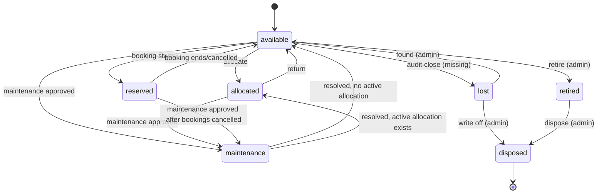
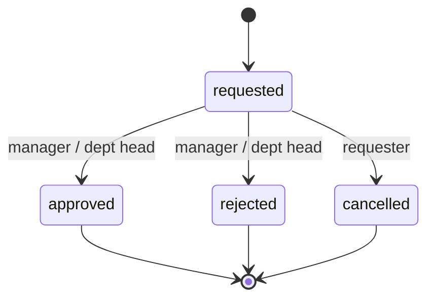
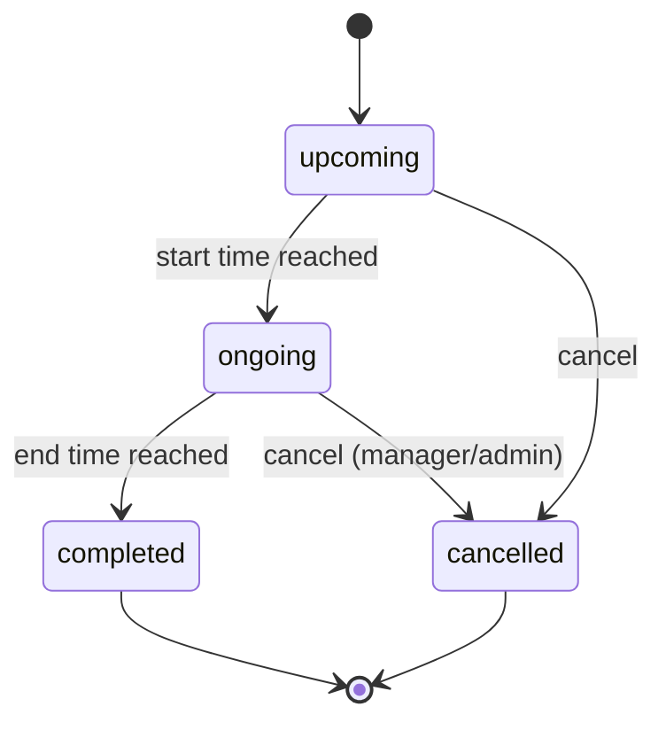
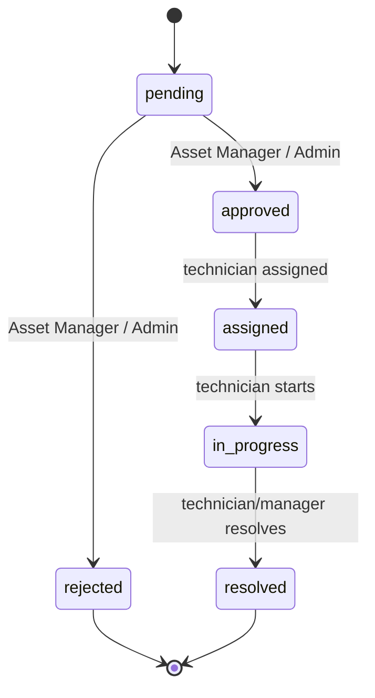
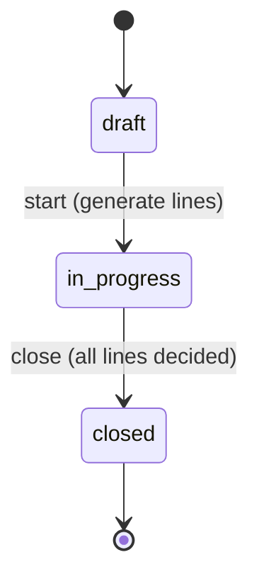

# Workflows, rules, RBAC, screens, KPIs, notifications

This is the behavioural contract. The model fields are in
[`domain-model.md`](domain-model.md); this document says what may change, who may change it, and what
the user sees.

## 1. State machines

### 1.1 Asset lifecycle



Rules enforced by code, not by the UI alone:

- `disposed` is terminal.
- Only audit close can move an asset to `lost`; only an admin can move it back.
- Retire/dispose requires admin and a reason note in chatter.
- Every transition appends a chatter message and an `assetflow.activity.log` row.

### 1.2 Allocation

`active -> returned`. There is no cancelled allocation; delete is forbidden once started.

### 1.3 Transfer



Approval is atomic: close the old allocation, create the new one, update the asset, mark approved.

### 1.4 Booking



Transitions are driven by a cron plus explicit cancel. `state` is stored so list filters and KPIs are
cheap.

### 1.5 Maintenance



### 1.6 Audit cycle



## 2. Business rules

| ID | Rule | Enforcement |
|----|------|-------------|
| R1 | Asset tags are generated once, immutable, unique (`AF-0001`). | `ir.sequence`, readonly field, unique constraint |
| R2 | Signup creates an Employee with no role. Only Admin promotes roles, from the Employee Directory. | `auth_signup` override + admin-only buttons + group write ACL |
| R3 | An asset cannot have two active allocations. | partial `models.UniqueIndex` + create guard |
| R4 | Allocating requires `state = available` and no current booking. | create guard under asset lock |
| R5 | Returning requires check-in condition and notes; asset becomes available unless another allocation is active. | return method + `@api.constrains` |
| R6 | Overdue = active allocation with `expected_return_date < today`. | computed search field; daily cron alerts |
| R7 | Two bookings of one asset may not overlap; intervals are half-open `[start, end)`, so 09:00-10:00 and 10:00-11:00 are valid. | overlap check under `lock_for_update()` |
| R8 | Only assets with `is_bookable = True` can be booked. | field domain + create/write guard |
| R9 | Maintenance approval is blocked while any non-cancelled booking exists; bookings are blocked while the asset is in maintenance. | guards in both addons |
| R10 | Only Asset Manager or Admin approve/reject maintenance. | button groups + method guard |
| R11 | Approving maintenance stores the prior state and flips the asset to `maintenance`; resolving restores the prior state (or `allocated` if an allocation is active). | approval/resolve methods |
| R12 | An audit cycle cannot close with undecided lines; closing locks it. | close guard + cycle write guard |
| R13 | Audit close sets missing assets to `lost` and damaged assets' condition to `damaged`. | close transaction |
| R14 | Deactivated departments/categories cannot be selected for new records but existing records keep them. | `active` + domain `[('active','=',True)]` |
| R15 | Acquisition cost is reporting data only; it never creates an accounting entry. | no accounting dependency |
| R16 | Every state change and every approval is recorded in the activity log and chatter. | helper in base called by transition methods |
| R17 | Employees see their own allocations/bookings/maintenance; Department Heads see their department; Managers/Admins see all. | ACLs + record rules |
| R18 | Records with history are archived, never deleted. | `active` field + `@api.ondelete` guards |
| R19 | A transfer has at most one pending request per asset. | partial `models.UniqueIndex` |
| R20 | Date/time comparisons use UTC; the UI shows the user's timezone. | field types + `fields.Datetime.context_timestamp` |
| R21 | Loss/disposal/return-to-service are admin actions and require a chatter note. | button groups + required note check |
| R22 | A booking cannot be created for a past end time. | create guard |

Sequence gaps are acceptable after a rollback; uniqueness and monotonic tags matter, not gapless
numbers.

For the activity log, a Department Head reads the rows attributed to their department or written by
their department's people. Rows logged before the log carried a department belong to no head;
managers and administrators still see them.

## 3. Roles and access

### 3.1 Groups

Defined once in `assetflow_base`, using the Odoo 19 privilege system:

- `group_assetflow_employee` implies `base.group_user`.
- `group_assetflow_department_head` implies employee.
- `group_assetflow_asset_manager` implies employee.
- `group_assetflow_admin` implies asset manager.

No AssetFlow group implies `base.group_system`. Odoo's system administrator remains a separate
account; the app admin role is enough for Organization Setup.

### 3.2 Capability matrix

Legend: **R** read, **W** write, **C** create, **D** delete/archive; "-" no access. "own/dept"
means record-rule scoped.

| Model | Employee | Department Head | Asset Manager | Admin |
|-------|----------|-----------------|---------------|-------|
| `assetflow.department` | R | R | R | CRUD |
| `assetflow.category` | R | R | R | CRUD |
| `assetflow.employee` | R own/dept | R own/dept | R all | CRUD |
| `assetflow.asset` | R own + bookable | R dept, W condition/location | CRUD | CRUD |
| `assetflow.allocation` | R own, W return own | R dept, W return dept | CRUD | CRUD |
| `assetflow.transfer` | C own, R own | R/W dept, approve | CRUD | CRUD |
| `assetflow.booking` | C/R/W own | C/R/W dept | CRUD | CRUD |
| `assetflow.maintenance.request` | C own asset, R own | C/R dept | CRUD + approve | CRUD |
| `assetflow.audit.cycle` | - | R dept | CRUD | CRUD |
| `assetflow.audit.line` | - | R dept | CRUD | CRUD |
| `assetflow.notification` | R/W own | R/W own | R/W own | R/W own |
| `assetflow.activity.log` | - | R dept | R | R |
| `res.users.employee_id` | R own | R own | R all | R all |

Auditors are employees temporarily granted write on the lines of the cycles they are assigned to;
that is a record rule, not a new role.

### 3.3 `res.users` extension

`assetflow_base` adds `employee_id` (Many2one `assetflow.employee`) to `res.users` so record rules can
express department scoping:

```python
class ResUsers(models.Model):
    _inherit = "res.users"

    employee_id = fields.Many2one("assetflow.employee", ondelete="set null", index=True)
```

Rules then use `user.employee_id.department_id`.

### 3.4 Record rule examples

```xml
<!-- Employee: own allocations -->
<record id="rule_allocation_employee" model="ir.rule">
    <field name="name">Allocation: own</field>
    <field name="model_id" ref="model_assetflow_allocation"/>
    <field name="groups" eval="[(4, ref('assetflow_base.group_assetflow_employee'))]"/>
    <field name="domain_force">[('employee_id.user_id', '=', user.id)]</field>
</record>

<!-- Department head: department allocations -->
<record id="rule_allocation_dept_head" model="ir.rule">
    <field name="name">Allocation: department</field>
    <field name="model_id" ref="model_assetflow_allocation"/>
    <field name="groups" eval="[(4, ref('assetflow_base.group_assetflow_department_head'))]"/>
    <field name="domain_force">[('asset_id.department_id', '=', user.employee_id.department_id.id)]</field>
</record>

<!-- Asset manager: all -->
<record id="rule_allocation_manager" model="ir.rule">
    <field name="name">Allocation: manager all</field>
    <field name="model_id" ref="model_assetflow_allocation"/>
    <field name="groups" eval="[(4, ref('assetflow_base.group_assetflow_asset_manager'))]"/>
    <field name="domain_force">[(1, '=', 1)]</field>
</record>
```

Group rules unify, so a manager who is also an employee sees the union. Do not add a global rule for
these models unless you intend an AND.

### 3.5 Security test requirements

For every model in the matrix, add tests with `new_test_user` for each role:

- an employee cannot read another employee's allocation;
- a department head can read department records but not another department's;
- a manager can read all;
- an employee cannot promote themselves or write `user_id.groups_id`;
- an auditor can write only their assigned cycle's lines.

## 4. Screen mapping

| Brief screen | Addon | Implementation |
|--------------|-------|----------------|
| 1. Login / Signup | `assetflow_base` | Odoo auth; `auth_signup` override creates an Employee with no role; forgot-password from core |
| 2. Dashboard / Home | `assetflow_reports` | OWL client action with KPI cards, overdue/upcoming lists, quick-action buttons |
| 3. Organization Setup | `assetflow_base` | Admin-only menu with three tabs/actions: Departments, Categories, Employees; role buttons on the employee form |
| 4. Asset Registration & Directory | `assetflow_assets` | Asset list, kanban by state, form with chatter + history tabs, search filters, QR/print action |
| 5. Allocation & Transfer | `assetflow_assets` | Allocation form/list, transfer wizard and approval actions; conflict message names the current holder |
| 6. Resource Booking | `assetflow_booking` | Calendar view by asset, list/form, overlap error with the conflicting slot |
| 7. Maintenance | `assetflow_maintenance` | Kanban by state + form with statusbar and approval buttons; technician assignment |
| 8. Asset Audit | `assetflow_audit` | Cycle form with editable line list; start/close buttons; discrepancy PDF |
| 9. Reports & Analytics | `assetflow_reports` | Graph/pivot dashboards, department allocation PDF, booking heatmap (OWL with pivot fallback) |
| 10. Activity Logs & Notifications | `assetflow_base` | Notification list with unread badge; activity log for managers; chatter on every business record |

Global rules for the UI:

- Every list that can grow has a search view with filters for state, department, category, and
  overdue/bookable.
- Destructive actions use confirmation wizards, not raw deletes.
- Status bars are driven by the state field and buttons are hidden by `groups=` where the role
  matters, in addition to server-side checks.

## 5. KPI definitions

`assetflow.dashboard.get_kpi_data()` returns exactly these keys:

| KPI | Definition |
|-----|------------|
| `assets_available` | `assetflow.asset` count with `state = available` |
| `assets_allocated` | count with `state = allocated` |
| `maintenance_today` | assets in `maintenance`, or open requests with `approved_at` today |
| `active_bookings` | bookings with `state = ongoing` at request time |
| `pending_transfers` | transfers with `state = requested` |
| `upcoming_returns` | active allocations with `expected_return_date` in the next 7 days |
| `overdue_returns` | active allocations with `expected_return_date < today` |
| `open_maintenance` | requests in `pending`, `approved`, `assigned`, `in_progress` |
| `unread_notifications` | current user's notifications with `is_read = False` |

Counts respect record rules, so an employee sees their own numbers and a manager sees the
organization. The dashboard must not use `sudo()` to make the numbers "look full".

## 6. Notifications

| Event | Recipients | Channel |
|-------|------------|---------|
| Asset allocated | Holder, Department Head | notification + chatter |
| Asset returned | Holder, manager | chatter |
| Transfer requested | Dept Head, Asset Manager | notification |
| Transfer approved/rejected | Requester, both holders | notification |
| Maintenance raised | Asset Manager | notification |
| Maintenance approved/rejected | Raiser | notification |
| Technician assigned | Technician | notification |
| Maintenance resolved | Raiser | notification |
| Booking created/cancelled | Booker, Department Head | notification |
| Booking reminder | Booker | notification, 15 minutes before start |
| Overdue return | Holder, Dept Head, Asset Manager | notification, daily |
| Audit started | Assigned auditors | notification |
| Audit discrepancy | Auditors, Asset Manager | notification + chatter |
| Audit closed | Auditors, Admin | chatter |

Cron jobs:

| Job | Model | Interval | Action |
|-----|-------|----------|--------|
| `Flag overdue returns` | `assetflow.allocation` | daily | create notifications once per allocation per day; chatter on first flag |
| `Booking reminders` | `assetflow.booking` | every 10 min | notify when start is within 15 min and `reminder_sent = False` |
| `Booking state sync` | `assetflow.booking` | every 5 min | upcoming -> ongoing -> completed; update asset reserved/available |
| `Maintenance aging` | `assetflow.maintenance.request` | daily | notify manager about pending requests older than 2 days |
| `Notification cleanup` | `assetflow.notification` | weekly | archive read notifications older than 90 days |

Cron methods must be idempotent: use flags (`reminder_sent`) or check for an existing notification
for the same record and day before creating another.

## 7. Concurrency and integrity

| Scenario | Mechanism |
|----------|-----------|
| Two allocations for one asset | `models.UniqueIndex("(asset_id) WHERE state = 'active'")` |
| Two overlapping bookings | transaction-local `asset.lock_for_update()` then overlap search |
| Two approvals of one transfer | lock the asset, re-read state, act only on `requested` |
| Audit close racing with line edits | lock the cycle row; writes check `state = in_progress` |
| Duplicate asset tags | `ir.sequence` + unique constraint |
| Duplicate open maintenance request | partial `UniqueIndex` on open states |
| Duplicate audit line | `UNIQUE(cycle_id, asset_id)` |

Odoo runs each request in one transaction. Never call `cr.commit()` inside these methods; if a lock
fails, let the transaction roll back and show the user a clear error.

## 8. Demo narrative (what the judges must see)

1. Admin creates departments and categories, then promotes one employee to Department Head and one
   to Asset Manager.
2. Asset Manager registers a laptop; the tag `AF-0001` appears.
3. The laptop is allocated to Priya; Raj tries to allocate it and is blocked with "currently held by
   Priya" plus a Transfer button.
4. Priya requests a transfer to Raj; the Department Head approves; history shows both holders.
5. Room B2 is booked 09:00-10:00; a 09:30-10:30 request is rejected; 10:00-11:00 succeeds.
6. Priya raises a maintenance request; it stays pending until the Asset Manager approves, then the
   asset flips to Under Maintenance and back on resolution.
7. Admin opens an audit cycle, assigns an auditor, marks one asset missing, closes, and the asset
   becomes Lost with a discrepancy report.
8. The dashboard shows the overdue return, the active booking, the pending transfer, and the open
   maintenance request; the notification list shows the generated alerts.
